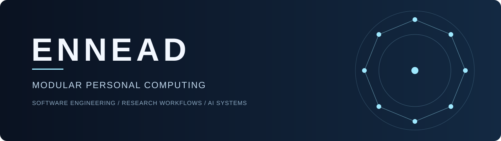
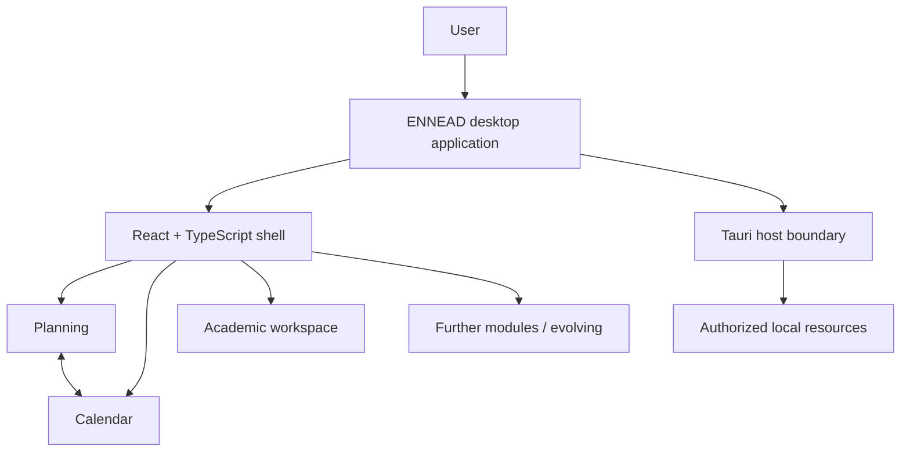

<h1 align="center">ENNEAD</h1>

<strong>Everyday Neural Navigator for Execution, Automation &amp; Decisions</strong>

<strong>A modular desktop environment for personal computing, research and AI-assisted workflows.</strong>

<em>Independent software project · Public showcase · Private application source</em>

<a href="docs/ARCHITECTURE.md">Architecture</a> ·
<a href="docs/ENGINEERING.md">Engineering case studies</a> ·
<a href="docs/ROADMAP.md">Development status</a> ·
<a href="docs/PUBLIC_DISCLOSURE.md">Disclosure policy</a>

---

## Overview

ENNEAD is an independently directed desktop software project exploring a unified environment for managing long-running projects, academic work, planning, creative workflows and AI-assisted tasks. The engineering goal is a coherent, extensible application—not simply a collection of disconnected utilities.

**This repository presents the project publicly. It does not distribute ENNEAD's production source code, internal Git history, personal data, credentials or application binaries.**

> **Status · 19 October 2026:** The Tauri desktop application exists and has been tested in its real application path. Implemented milestones include academic workbench integration, calendar views over planning data and an ambient visual system. The product remains in active development; planned capabilities are not presented as shipped.

## What has been implemented?

| Area | Documented scope | Status |
| :-- | :-- | :-- |
| **Desktop application** | Tauri host with React / TypeScript interface | Implemented; evolving |
| **Planning & calendar** | Month, week and day views, 30-day agenda and existing planning records | Implemented; evolving |
| **Academic workbench** | Workbench integrated into the actual app, with a navigable file tree and open/split interactions | Implemented; evolving |
| **Ambient interface** | Seasonal and time-of-day backgrounds, transitions and preview controls | Implemented |
| **Persistent events & recurrence** | Dedicated event model and recurring appointments | Not delivered in the documented calendar milestone |
| **Broader AI & creative workflows** | Extended module integrations | Ongoing / planned |

These statuses are based on recorded development milestones, **not** claims of an independently audited or publicly downloadable release.

## Engineering: beyond the interface

ENNEAD's technical emphasis is on **modular software architecture**, **cross-view data coherence**, **real-application integration** and **explicit validation**.

- **Calendar over existing planning data:** establish useful time-based views while distinguishing tasks and milestones from persistent calendar events that do not yet exist.
- **Prototype-to-application integration:** move academic workspace interactions into the actual application rather than relying on a detached demonstration page.
- **Verified interface delivery:** check TypeScript/build integrity, targeted tests and behavior in the real desktop runtime.

Read the [bounded engineering case studies](docs/ENGINEERING.md) for the problem, design rationale, delivered scope and evidence limitations.

## Public system overview

*Illustrative boundaries only: not an internal specification or a full implementation diagram.* More details: [Architecture](docs/ARCHITECTURE.md).

## Visual presentation

An original [project cover](assets/ennead-cover.svg) and a standalone [static showcase page](index.html) are included. **Actual application screenshots and a walkthrough will be added only after a separate privacy and rights review.** Mock-ups will never be labeled as implemented UI.

## Technology & methodology

**Technology:** Tauri · React · TypeScript · Rust host layer.

**Practices:** modular engineering · integration testing · milestone-based verification · review of design trade-offs · transparent distinction between proposed, implemented and verified behavior.

The project is independently directed with AI-assisted coding/research tools supporting parts of implementation. The project maintainer remains responsible for system specifications, architecture decisions, acceptance criteria and technical review. These responsibilities must not be confused with writing every line of code manually.

## Research context

ENNEAD complements interests in computational physics, scientific computing and research tooling; it is **not** itself a scientific paper or evidence for a physics result.

Related independent project: [Quant Research Lab](https://github.com/Weini247/quant-research-showcase).

## Source availability & rights

**Closed-source application; public documentation-only showcase.** No general open-source license is granted here. GitHub viewing and platform-enabled forking remain subject to its terms. See [NOTICE](NOTICE.md) and the [public disclosure policy](docs/PUBLIC_DISCLOSURE.md).

---

ENNEAD · Independent development · Public status updated 19 October 2026

