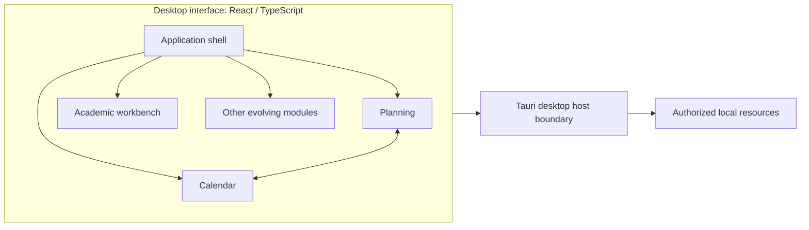

# ENNEAD — Public Architecture Overview

> A deliberately high-level map. It is not an internal implementation specification.

## Architectural objectives

1. **Modularity:** each domain owns coherent responsibilities.
2. **Desktop integration:** local-system operations cross an explicit desktop host boundary.
3. **State coherence:** related views should derive from shared conceptual data.
4. **Validation:** acceptance depends on the integrated application, not merely a prototype.
5. **Evolution:** differentiate delivered, experimental and planned capabilities.

## Public conceptual architecture

This intentionally omits schemas, IPC details, permissions, algorithms, provider configurations and private file organization.

## Documented development areas — October 2026

**Academic workspace:** real-app integration, file-tree navigation and contextual open/split interactions.

**Planning-aware calendar:** month/week/day views and a 30-day agenda that surface existing planning tasks, milestones and project records. Editing existing tasks is possible in the documented milestone. A persistent general event model and recurrence are *not* claimed.

**Ambient interface:** 16 season/time-of-day assets, automatic transitions and manual preview/override controls.

## Evaluation criteria

A proposed feature should be demonstrable in the real desktop application, have appropriate persistence where required, be testable beyond a prototype, and communicate incomplete states clearly.

See [Engineering case studies](ENGINEERING.md).
